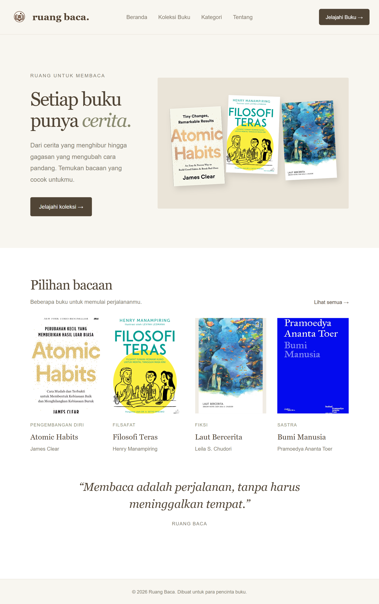

# Praktikum Laravel - Routing dan MVC

Nama: Muhamad Rizal Rivardi
NIM: C2483207007
Kelas: PTI5A
Tema/Judul: Ruang Baca - Katalog Buku

## Deskripsi Aplikasi
Ruang Baca merupakan aplikasi katalog buku yang membantu
pengguna menemukan buku berdasarkan judul dan kategori.

## Implementasi Routing, Controller, dan View
Di project Ruang Baca ini, saya menggunakan Routing untuk mengatur halaman yang bisa diakses oleh pengguna. Saya membuat beberapa route, yaitu halaman beranda, daftar buku, detail buku, kategori, dan tentang. Setiap route diarahkan ke Controller yang sesuai.
Untuk Controller, saya menggunakan HomeController dan BukuController. HomeController digunakan untuk mengatur halaman beranda dan tentang, sedangkan BukuController digunakan untuk menampilkan daftar buku, detail buku, dan kategori. Data buku saya simpan dalam bentuk array di Controller, jadi project ini tidak menggunakan database.
Untuk bagian View, saya menggunakan Blade Template Laravel yang disimpan di folder resources/views. Saya membuat tampilan untuk setiap halaman dan menggunakan layout utama agar desain navbar, warna, dan tampilan website tetap konsisten. Saya juga menggunakan perulangan @foreach untuk menampilkan data buku, sehingga daftar buku bisa ditampilkan tanpa menulis kode HTML satu per satu.
Dengan penerapan Routing, Controller, dan View ini, alur aplikasi menjadi lebih teratur, mulai dari pengguna membuka halaman, Controller mengatur data yang dibutuhkan, sampai View menampilkan hasilnya di browser.

## Screenshot

## Cara Menjalankan Proyek
1. Clone repository.
2. Jalankan composer install.
3. Salin .env.example menjadi .env.
4. Jalankan php artisan key:generate.
5. Jalankan php artisan serve.
6. Buka alamat localhost yang ditampilkan.
